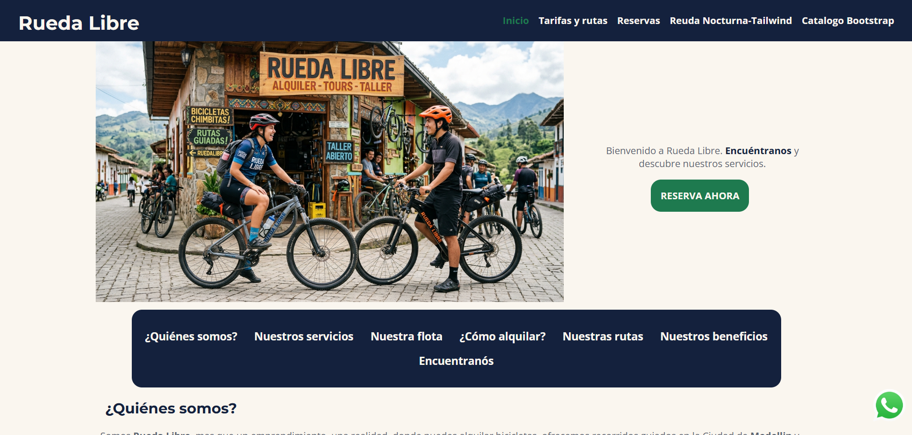
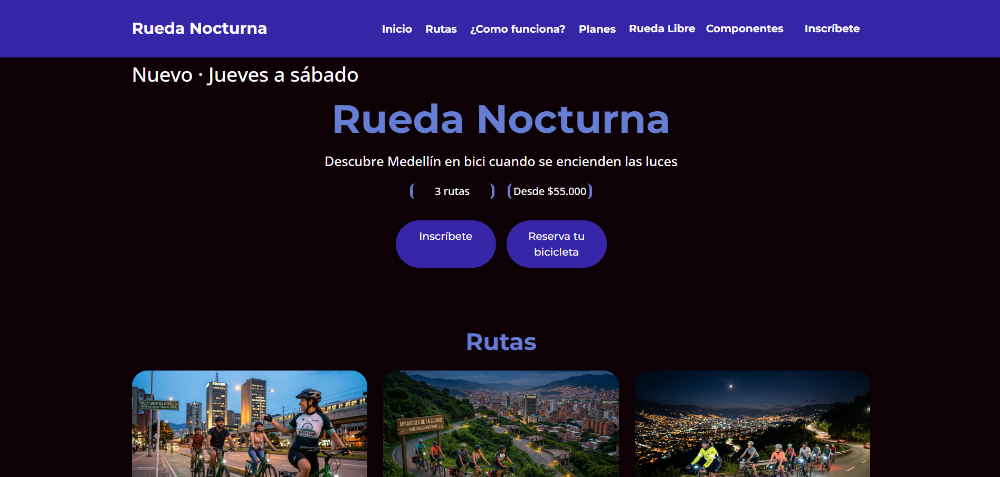

# Rueda Libre

Ecosistema web para **Rueda Libre**, un negocio de alquiler de bicicletas y recorridos guiados. Incluye el sitio principal (v2.0) y la landing **Rueda Nocturna**, enlazados entre sí.

## Enlaces publicados

- Sitio Rueda Libre v2.0: https://santiagoarboleda19.github.io/rueda-libre/
- Landing Rueda Nocturna: https://santiagoarboleda19.github.io/rueda-libre/nocturna/nocturna.html

## Páginas

- **Inicio (`index.html`):** portada, quiénes somos, servicios, cómo alquilar, beneficios, flota y sección para encontrarnos.
- **Tarifas y rutas (`paginas/tarifas.html`):** tablas con los precios de alquiler y de los recorridos guiados.
- **Reservas (`paginas/reservas.html`):** formulario de reserva validado, con campos agrupados en `fieldset`, y horarios de atención.
- **Landing Rueda Nocturna (`nocturna/nocturna.html`):** rutas nocturnas, pasos para participar y formulario de inscripción, con modo claro y oscuro.
- **Prueba con Bootstrap (`pruebas/catalogo-bootstrap.html`):** catálogo de la flota hecho solo con la grilla de Bootstrap, para comparar frente a mi CSS propio.

## Tecnologías

- HTML semántico
- CSS propio con variables, Flexbox y Grid (sitio)
- Tailwind CSS (landing Rueda Nocturna), con la configuración de la marca y modo oscuro
- Bootstrap 5.3, solo en la página de pruebas
- GitHub Pages para publicar
- DevTools para revisar contraste, responsive y modo oscuro

## Recomendación de framework: Bootstrap vs Tailwind CSS

Conocí Bootstrap de forma introductoria y trabajé a fondo con Tailwind CSS. Aunque Bootstrap no se implementó ampliamente en el proyecto, me permitió ver las diferencias entre ambos.

**Curva de aprendizaje.** Bootstrap permite construir interfaces rápido con componentes y clases ya hechos, y es fácil de empezar. Tailwind exige aprender sus clases de utilidad y combinarlas, lo que al principio parece más complejo, pero da control sobre cada detalle.

**Personalización.** En Bootstrap, cuando se necesita una apariencia muy específica puede tocar sobrescribir varios estilos. En Tailwind pude adaptar colores, tipografías, distribución, estados y modo oscuro directamente en el HTML, con la configuración de la marca.

**Tamaño final.** El CSS minificado de la landing con Tailwind pesó **15,58 KB**. El CSS propio del sitio pesó **13,45 KB**. No medí Bootstrap dentro del proyecto, porque no incorporé su JavaScript ni lo usé completo, así que la comparación es entre el CSS de Tailwind y mi CSS hecho a mano.

**Experimento con la grilla de Bootstrap.** Rehice la distribución de la flota solo con la grilla. Mi CSS propio usaba 8 líneas para repartir las tarjetas y con Bootstrap usé 8 clases distintas, así que no escribí menos: lo que gané fue no tener que escribir ni mantener CSS ni `@media`. Los resultados no fueron iguales: mi `auto-fill` con `minmax(23rem, 1fr)` decide solo cuántas columnas caben y nunca pasa de 3, mientras que Bootstrap fija 1, 2, 3 y 4 columnas en puntos de corte concretos. También perdí control: las columnas quedan atadas a los puntos de corte de Bootstrap, dependo de nombres de clases ajenos y cargo toda la librería para usar solo la grilla.

**Recomendación.** Para Rueda Libre recomiendo **Tailwind CSS**, porque el proyecto necesita una identidad visual propia, con colores, tipografías, componentes y diseños adaptables a diferentes dispositivos. Además, sus utilidades permiten personalizar en el marcado y reutilizar patrones con `@apply` cuando hay estilos repetidos, como los botones de Rueda Nocturna.

## Capturas

**Escritorio (1280 px)**

**Celular (360 px)**

**Modo oscuro**

## Aprendizajes

- **Accesibilidad:** corregí los `alt` de las imágenes (descriptivos en las importantes y vacíos en las decorativas) y la jerarquía de encabezados, que saltaba de `h1` a `h3`.
- **Contraste:** comprobé las combinaciones de la paleta con WCAG AA. Descubrí que el naranja no sirve como texto sobre crema ni con texto blanco, así que lo reservé para detalles decorativos y botones secundarios con texto azul oscuro.
- **Especificidad:** un selector con id (`#menu a`) pisaba a `.activo`, por eso el color del enlace activo no se aplicaba. Lo resolví eliminando el selector más fuerte y apoyándome en la herencia desde `body`.
- **Box model:** al cambiar `box-sizing` medí con DevTools cómo cambia el ancho total de un elemento.
- **Flexbox y Grid:** usé Flexbox para encabezado, pie de página y filas del formulario, y Grid para la portada y las galerías de tarjetas.
- **Formularios:** probé la validación con datos vacíos, inválidos y válidos, y comprobé que se puede completar solo con el teclado. Falta conectar un servidor para guardar las inscripciones.
- **Responsive:** revisé la landing a 360, 768, 1024 y 1280 px. Gracias al enfoque mobile first no hubo desbordamientos a 360 px.
- **Tailwind:** definí reglas del kit (colores, escala de espaciado y radios de borde) para mantener la consistencia entre componentes.

## Autor

Santiago Arboleda Vahos
